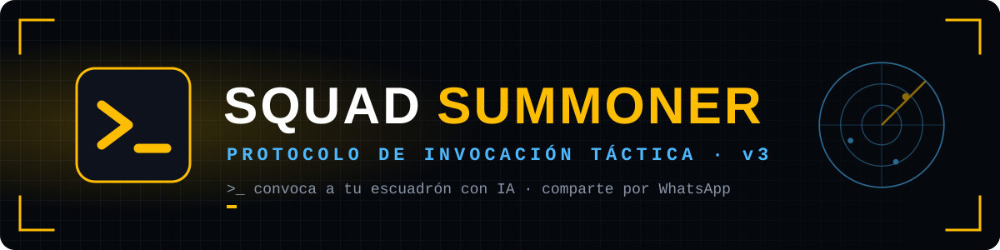
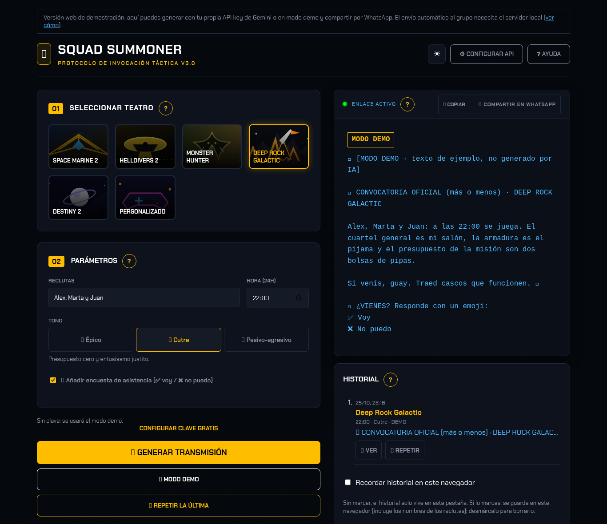
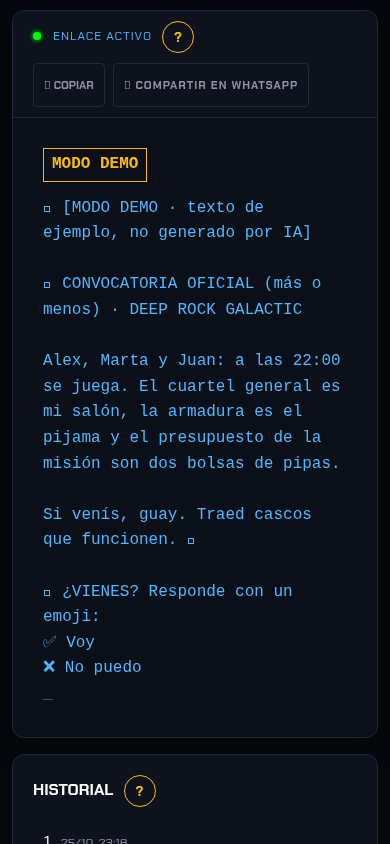

*«No mandes un simple "¿jugamos?". Manda una orden de movilización orbital.»*

### [▶ Abrir Squad Summoner](https://bertmarti.github.io/squad-summoner-v3/)

---

## 🎖️ ¿Qué es?

**Squad Summoner** es una pequeña web para gamers con un único objetivo: **conseguir que tu grupo se conecte a jugar**.

Eliges el juego, escribes quién tiene que venir y a qué hora, y la IA de **Google Gemini** redacta una convocatoria
épica metida de lleno en el papel: propaganda de la Super Tierra, decretos del Administratum o un aviso de caza desde la
cantina. Luego la copias o la mandas por WhatsApp con un toque.

## 🎯 ¿Para qué sirve?

- Para dejar de escribir «¿jugamos esta noche?» y que nadie conteste.
- Para que el grupo se ría (y se sienta un poco culpable si llega tarde).
- Para tener un mensaje distinto cada vez, con el tono de cada juego:

| Juego | Tono de la transmisión |
|---|---|
| 🏴 **Helldivers 2** | Propaganda máxima por la Democracia Gestionada. ¡LIBER-TÉ! |
| ⚔️ **Space Marine 2** | Decretos góticos del Imperio: la impuntualidad es herejía. |
| 🐾 **Monster Hunter** (World, Rise o Wilds) | La Encargada te espera en la cantina con las armas afiladas. |
| ⛏️ **Deep Rock Galactic** | ¡Rock and Stone! La extracción no espera a ningún enano. |
| 🌌 **Destiny 2** | Convocatoria para Guardianes: el destino de la escuadra está en juego. |
| 🖊️ **Personalizado** | Escribes el nombre de tu juego y la IA se mete en su papel. |

## 📸 Así se ve

  
  &nbsp;
  

## 🕹️ Cómo se usa, paso a paso

1. **Abre la web**: <https://bertmarti.github.io/squad-summoner-v3/> (funciona en el ordenador y en el móvil).
2. **01 · Selecciona el teatro**: toca la tarjeta de tu juego.
3. **02 · Parámetros**: escribe los nombres de los reclutas (por ejemplo «Alex, Marta y Juan») y la hora.
4. Elige el **tono**: Épico, Cutre o Pasivo-agresivo. El épico es el tono predeterminado.
5. Si quieres, marca **📋 Añadir encuesta de asistencia (✅ voy / ❌ no puedo)** para añadir esas respuestas al final del mensaje.
6. Pulsa **📢 GENERAR TRANSMISIÓN** y mira cómo aparece la orden en el terminal.
7. Envíala:
   - **📋 COPIAR** para pegarla donde quieras, o
   - **🟢 COMPARTIR EN WHATSAPP**, que abre WhatsApp con el texto listo: solo eliges el grupo y envías.

¿Quieres otra versión? Vuelve a pulsar el botón: cada transmisión es distinta.

## 🗂️ Historial y repetir la última

El panel **HISTORIAL** conserva las últimas 10 transmisiones durante la visita. Pulsa **VER** para recuperar una o
**REPETIR** para generar otra con el mismo juego, reclutas, hora y tono. También puedes usar **🔁 REPETIR LA ÚLTIMA** bajo
los botones de generación. Por defecto el historial se borra al recargar; marca **Recordar historial en este navegador** si
quieres conservarlo. **VACIAR HISTORIAL** lo elimina cuando quieras.

La primera vez verás una guía de bienvenida con tres pasos. Puedes volver a abrirla cuando quieras con **❓ AYUDA** en la
cabecera. En cada sección encontrarás también un botón **?** con ayuda contextual.

## 🔑 Modo demo y tu API key

- **Sin configurar nada** la web funciona en **modo demo**: usa textos de ejemplo escritos a mano, siempre marcados con
  `🧪 [MODO DEMO · texto de ejemplo, no generado por IA]`. También puedes forzarlo con el botón **🧪 MODO DEMO**.
- **Para que escriba la IA** necesitas una clave de Gemini (gratis):
  1. Entra en [Google AI Studio](https://aistudio.google.com/apikey) con tu cuenta de Google y crea una *API key*.
  2. En Squad Summoner pulsa **⚙️ CONFIGURAR API**, pégala y pulsa **PROBAR CLAVE**.
  3. Si la comprobación es correcta, pulsa **GUARDAR**. La casilla **Recordar en este navegador** está desmarcada por
     defecto.
- Sin marcar esa casilla, la clave vive solo en memoria y se olvida al cerrar o recargar la web. Si decides marcarla, lee
  el aviso: todas las webs de `bertmarti.github.io` comparten el almacenamiento del navegador. Puedes revocar la clave en
  [Google AI Studio](https://aistudio.google.com/apikey) y borrarla desde **⚙️ CONFIGURAR API** → **BORRAR CLAVE**.
- La clave se envía directamente a Google; la web publicada no lleva ninguna clave dentro.

## 📲 Envío automático a tu grupo (opcional)

La web pública comparte por WhatsApp, pero eres tú quien pulsa «enviar». Si quieres que el mensaje llegue **solo** a un
grupo concreto, puedes ejecutar la torre de comunicaciones en tu ordenador:

1. Instala [Node.js](https://nodejs.org/) (versión LTS) y descarga el proyecto: en GitHub, botón verde **Code → Download ZIP**
   (y descomprímelo), o `git clone https://github.com/BertMarti/squad-summoner-v3.git`.
2. Abre una terminal en la carpeta del proyecto y ejecuta `npm run setup`. Responde **s** a «¿Quieres configurar el envío
   automático…?»: el asistente comprueba lo que falta, instala lo necesario y prepara la configuración.
3. Ejecuta `npm run server:grupos`. Escanea el QR y elige el grupo; el ID se guardará automáticamente.
4. Para escanearlo: WhatsApp → Ajustes → Dispositivos vinculados → Vincular un dispositivo.
5. Arranca la torre con `npm run server` y déjala abierta. En **otra** terminal ejecuta `npm run dev` y abre
   <http://localhost:5173>: junto a cada transmisión aparecerá **📲 ENVIAR AL GRUPO**.

### ¿Lo usas desde otro equipo de casa?

`npm run setup` crea un **token secreto** en tu archivo `.env` (`SERVER_TOKEN`) sin mostrarlo en pantalla. Si abres la web
con `npm run dev` en el mismo ordenador, la web lo usa sola y no tienes que hacer nada.

Si quieres usar la torre desde otro equipo de casa (por ejemplo, la torre en una Raspberry Pi en `192.168.1.50`):

1. En el `.env` del equipo de la torre pon `HOST=0.0.0.0` y añade a `ALLOWED_ORIGINS` la dirección desde la que abrirás la
   web (por ejemplo `http://192.168.1.50:5173`). Reinicia con `npm run server`.
2. Sin token, la torre **se niega a arrancar** abierta a la red: así nadie más de tu wifi puede mandar mensajes a tu grupo.
3. En la web, abre **⚙️ CONFIGURAR API** → **Servidor de WhatsApp (opcional)** y pega el valor de `SERVER_TOKEN`. Solo se
   usa durante esa visita: no se guarda en el navegador.

La web publicada en GitHub Pages no muestra esta opción (no puede hablar con tu torre).

La sesión queda en tu ordenador. El botón **🟢 COMPARTIR EN WHATSAPP** sigue funcionando sin instalar el servidor.

## 🧭 Lo que tienes que hacer tú

- Consigue tu clave gratuita en [Google AI Studio](https://aistudio.google.com/apikey) si quieres usar la IA; si no, usa el modo demo.
- Si instalas el servidor en una Raspberry Pi, instala antes Chromium con `sudo apt install chromium`.

## ❓ Preguntas frecuentes

<b>¿Es gratis?</b>

Sí. La web es gratuita y de código abierto, y Google ofrece claves de Gemini con un uso gratuito más que suficiente para
convocar a tu escuadrón. En modo demo no necesitas ni eso.

<b>¿Se guarda mi historial?</b>

No por defecto: solo vive en memoria y desaparece al recargar. Si marcas **Recordar historial en este navegador**, se guarda
en ese navegador e incluye los nombres de los reclutas. Puedes desmarcarlo o pulsar **VACIAR HISTORIAL**.

<b>¿Qué es la encuesta de asistencia?</b>

Es un bloque que se añade al final del mensaje para que el grupo responda con **✅ voy** o **❌ no puedo**. No depende de la
IA y respeta el límite de 4000 caracteres.

<b>¿Para qué sirve el token?</b>

Protege el servidor de WhatsApp cuando lo abres a otros equipos de tu casa. Se envía de forma segura junto a la petición y no
se incluye en la dirección web. Si usas solo `localhost`, no necesitas configurarlo manualmente.

<b>¿Mi API key está segura?</b>

Por defecto vive solo en memoria y se olvida al cerrar o recargar. Si marcas **Recordar en este navegador**, se guarda en el
almacenamiento local: todas las webs de `bertmarti.github.io` comparten ese origen. Solo se envía a Google para generar el
texto. No la guardes en ordenadores compartidos, puedes revocarla en AI Studio y borrarla con **BORRAR CLAVE**.

<b>¿Por qué mi mensaje pone «MODO DEMO»?</b>

Porque no hay ninguna clave configurada (o pulsaste el botón de demo). Configura tu API key para que el texto lo escriba
la IA y sea distinto cada vez.

<b>¿Puede WhatsApp bloquear mi cuenta?</b>

Compartir con el botón 🟢 es como enviar un mensaje normal. El envío automático usa una librería **no oficial** que
controla WhatsApp Web: úsala con moderación, en tus propios grupos y sin hacer spam.

<b>¿Funciona en el móvil?</b>

Sí. La web se adapta a pantallas pequeñas y el botón de compartir abre directamente la app de WhatsApp.

<b>Mi juego no está en la lista, ¿qué hago?</b>

Elige **Personalizado** y escribe su nombre: la IA hará de narrador de ese juego.

<b>¿Hay modo claro?</b>

Sí, con el botón ☀️ de arriba a la derecha. La web recuerda tu elección.

## 🛡️ Aviso legal

Este proyecto usa librerías de terceros para la automatización de WhatsApp. Úsalo con responsabilidad y evita el spam.
El Administratum no se hace responsable de bloqueos por parte de Meta.

**SQUAD SUMMONER** no está afiliado con Arrowhead Game Studios, Capcom ni Games Workshop. Los nombres de los juegos
pertenecen a sus dueños; las ilustraciones de la web son propias.

---

¿Quieres instalarla o colaborar? Mira la [guía de desarrollo](docs/DESARROLLO.md). · Licencia [MIT](LICENSE) © BertMarti
